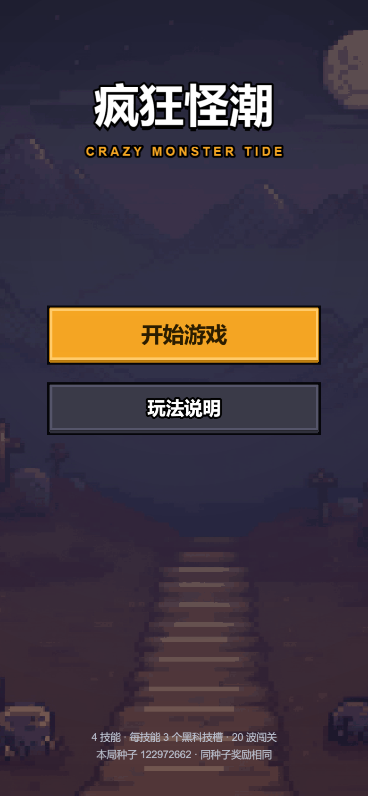
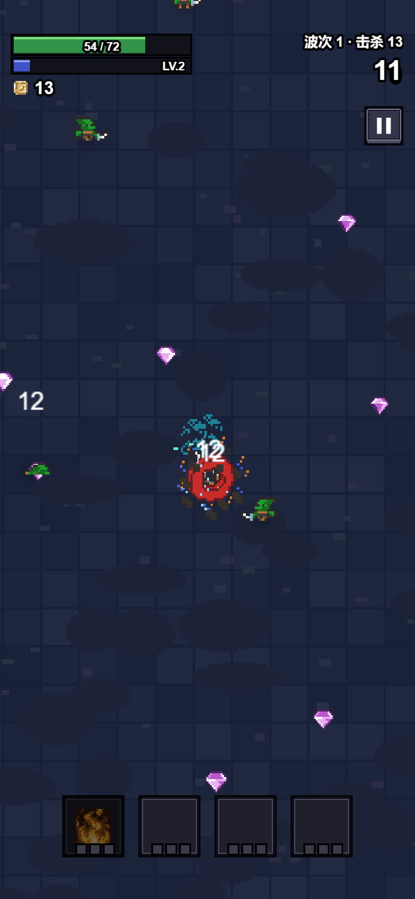
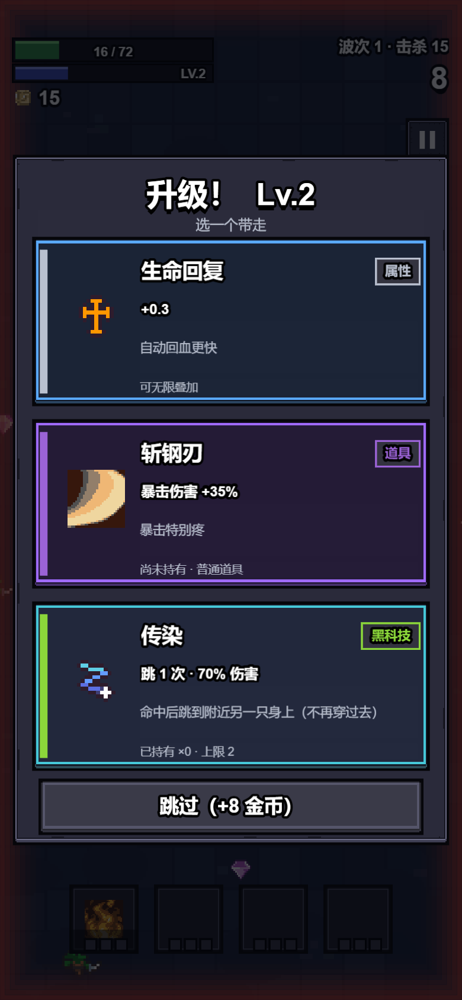
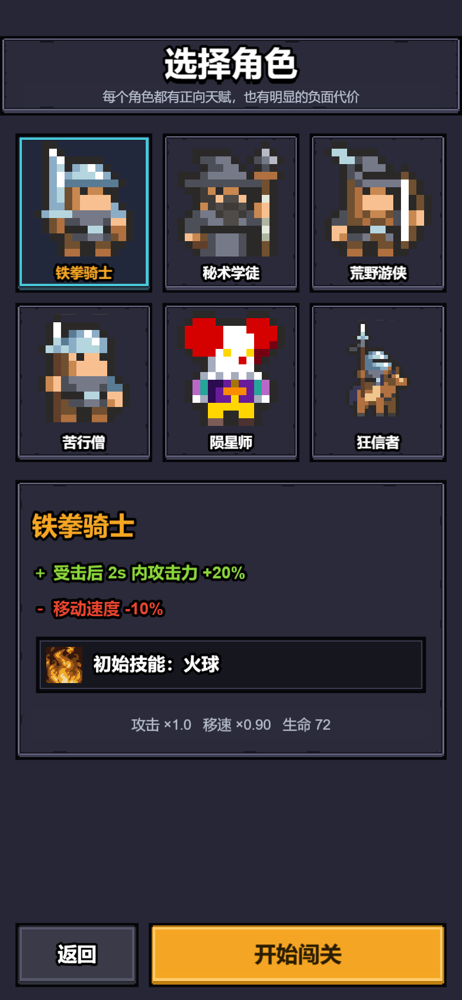
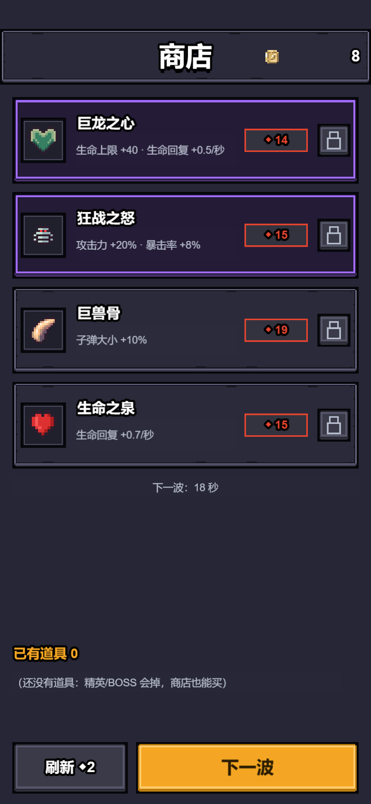

# 《疯狂鸽王》 crazy_monster_tide

> 竖屏像素风 · 自动攻击割草 · 构筑向肉鸽 · 微信小游戏
> **Cocos Creator 3.8.6 + TypeScript** ｜ 设计分辨率 **360×640 竖屏** ｜ 当前进度 **阶段3 收尾（349 PASS / 0 FAIL）**

**一句话玩法**：你只负责走位，技能自动开火；4 个主动技能 × 每个 3 个可插拔「黑科技」槽，
怪潮铺满屏幕，撑过 20 波就算通关（每 3 波精英，第 10 / 20 波 BOSS）。



> **当前状态（2026-10-31）**：阶段3 收尾完成，测试 **349 PASS / 0 FAIL**，微信包 **3.06MB / 10.90MB**。
> 接手先读 `docs/HANDOFF.md`；本轮交付包在 `deliverables/stage3_2026-10-31/`（含复核报告与真实截图）。

---

## 30 秒读懂这个仓库

| 你想知道 | 去读 |
|---|---|
| 这游戏到底要做什么 | `docs/requirements.md`（唯一需求来源） |
| 玩法规则（技能/模块/属性/波次/奖励…） | `docs/systems/` |
| **UI 规范与落地说明** | `docs/ui/`、`docs/ui-redesign/` |
| 现在做到哪、做过什么决定、踩过什么坑 | `memory-bank/`（tasks / decisions / rules / architecture） |
| 代码 | `cocos/assets/scripts/` |
| 素材来源与授权 | `docs/ui-redesign/asset_usage_manifest.md`、`docs/assets/` |
| 给 AI Agent 的入口 | `AGENTS.md`（仓库地图 + 红线 + 路由表） |

> 这是一个 **Agent 驱动**的工程：`AGENTS.md` 是地图，`docs/` 是按需读取的规则仓库，
> `memory-bank/` 是实时状态。单次任务只读命中的 1~3 个文件，不做全量加载。

---

## 目录结构

```
AGENTS.md                  Agent 地图：路由表 + 红线（开工必读）
README.md                  本文件
START_PROMPT.md            新会话启动提示词
build-wechat.bat           微信小游戏一键构建（唯一正确的出包入口）
LICENSE                    MIT

cocos/                     Cocos Creator 工程（真正的游戏本体）
  assets/scripts/          TypeScript：battle / ui / data / game / engine
  tests/run.ts             纯逻辑单测（349 条断言，不需要编辑器）
  build/                   构建产物：wechatgame（导入微信开发者工具）/ web-mobile（截图用）
  library/, temp/          Cocos 生成物（已 gitignore）

docs/                      规格、设计、评审与状态
  design/                  设计文档 + 最终裁决（FINAL_DESIGN_DECISIONS / 技能 / 难度 / 伤害接口）
  review/                  阶段3 初审 + 最终复核报告
  systems/ ui/ assets/ …   按需读取的规则仓库
  implementation_status.md 设计 → 实现 → 测试 对照表
  HANDOFF.md               新会话接手入口

memory-bank/               项目实时状态（tasks / decisions / rules / architecture / HANDOFF）
tools/                     构建、截图、素材索引、数值分析脚本
tests/                     早期 HTML 原型的 E2E / 门禁脚本（e2e_mvp.cjs / gate_mvp.cjs）
assets/                    素材源与第三方包（含 License；assets_index/ 为素材索引）
prototype-html/            早期竖屏 HTML 可玩原型
screenshots/               历史 UI 截图（按批次分子目录）
reports/                   历史数值 / 工程报告
archive/                   ★ 本机杂物：调试日志、旧评审包（已 gitignore，不进仓库）
deliverables/              ★ 交付包：阶段交付目录与 zip（已 gitignore，不进仓库）
```

---

## 怎么跑起来

**前置**：Cocos Creator **3.8.6**（仓库不含引擎本体）、Node.js ≥ 18。

1. 用 Cocos Creator 打开 `cocos/` 目录（首次会自动导入资源、生成 `library/`，约 1~3 分钟）。
2. 打开 `assets/scenes/Boot.scene`，点预览即可（竖屏，建议窗口比例接近 9:19.5）。

**构建**（需先关闭编辑器）：

```bat
REM 微信小游戏：唯一正确入口（直接调 Creator CLI 可能静默不产出）
cmd /c "build-wechat.bat -nopause"
REM 产物：cocos/build/wechatgame（微信开发者工具导入这个目录）

REM 网页包（截图 / 浏览器调试）
CocosCreator.exe --project <仓库>/cocos --build "platform=web-mobile;debug=false"
```

> ⚠️ 两个踩过的坑：① 环境里若有 `ELECTRON_RUN_AS_NODE=1`，编辑器会退化成一个 node 进程并报
> `bad option: --project`，先清掉该变量；② 编辑器开着的时候 CLI 构建会拿不到锁。

**单测**（纯逻辑层，不需要编辑器）：

```bash
cd cocos
node <tsx-cli> tests/run.ts     # 当前：PASS 349 / FAIL 0
```

---

## 历史一轮：UI 专项改造（M66）

原来的 UI 是「程序化圆角方块」拼的，这次换成一整套**真实像素九宫格素材**并重排了所有页面。

| 做了什么 | 说明 |
|---|---|
| 素材 | **Kenney Pixel UI Pack（CC0）** → 按本作暗色调色板重上色，生成 19 张 52×52 九宫格 + Cocos meta |
| 组件层 | `ui/UIKit.ts` 全部改为素材优先（缺素材自动回退 Graphics）；按钮按下换图、热区 ≥44；新增安全区模块 `ui/Safe.ts` |
| 页面 | 战斗 HUD / 升级三选一 / 主菜单 / 角色选择 / 商店 / 结算 / 暂停构建面板 / 黑科技安装 / 技能替换 / 二次确认 / 玩法说明 |
| 表现 | 精英/BOSS 由「地面光圈」改为**身体泛光**（两层同帧放大副本） |
| 稳定性 | 卡死看门狗（暂停但无弹窗 2s 自动恢复）+ 四处界面构建 try/catch + 结算单次触发闸门 |

**【必读文档】**

- `docs/ui-redesign/README_请先看.md` — 交付包入口
- `docs/ui-redesign/ui_pages_v2.md` — **逐页布局/绑定数据/交互/适配**（改 UI 先看这个）
- `docs/ui-redesign/asset_usage_manifest.md` — 素材逐文件清单与 CC0 授权记录
- `docs/ui-redesign/delivery_report.md` — 交付报告（含构建/测试结果、卡死排查结论、未验证项）

### 截图（三档视口 × 14 屏，全部在 `screenshots/ui-redesign/`）

| 战斗 HUD | 升级三选一 |
|---|---|
|  |  |

| 角色选择 | 商店 |
|---|---|
|  |  |

- 精英 / BOSS 身体泛光：`screenshots/ui-redesign/390x844-04b-elite-boss.png`
- 12 屏总览（360×640）：`screenshots/ui-redesign/_sheet-360x640.png`
- 设计分辨率基准：`screenshots/ui-redesign/360x640-*` ／ 宽屏比例：`412x915-*`

---

## 技术要点（给接手的人）

- **渲染**：全程 2D UI（`Graphics` + `Sprite`），像素素材强制 **NEAREST** 过滤，九宫格四角不拉伸。
- **适配**：设计分辨率写死 360×640 + `FIXED_WIDTH`；所有贴边元素按 `view.getVisibleSize()` 与安全区换算，
  禁止写死 640（历史事故见 `memory-bank/rules.md` KI-009）。
- **确定性**：一局一个随机种子，同种子同奖励/同商店，方便复现问题。
- **数据驱动**：16 技能 / 24 属性 / 70 道具 / 18 黑科技全是数据表，UI 只渲染，不重算规则。

---

## 第三方素材与许可

| 素材 | 授权 | 位置 |
|---|---|---|
| **Kenney Pixel UI Pack**（UI 九宫格来源） | **CC0 1.0**（可商用、无需署名） | 原始包 `assets/ui/third_party/kenney_pixel_ui_pack/`（含 `License.txt`），游戏内使用见 `cocos/assets/resources/ui/kenney/` |
| 角色 / 怪物 / 技能特效 | 项目已通过素材门禁（CC0 / 可商用），逐项登记在 `docs/assets/` | `cocos/assets/resources/art/` |
| 生成物 | `tools/art/gen_ui_kit.py` 只做调色 + 加边 + 导出，可复跑 | — |

项目代码采用 **MIT** 许可，见 `LICENSE`。

---

## 历史来源（本机路径，仅供参考）

需求与素材最初来自本机的 `pixel_roguelike_wechat_agent_kit` 母本工程与《行囊守卫》的 Agent 文档体系，
迁移决策记录在 `memory-bank/decisions.md`（D-04 等）。这些路径只在本机有效，仓库内不依赖它们。
