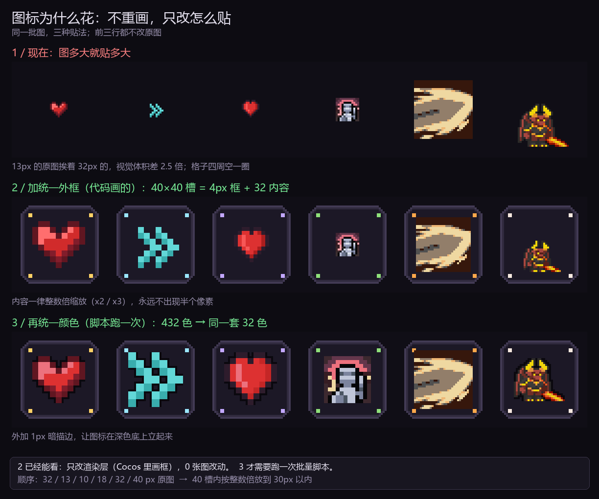
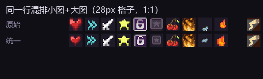

# 画风统一：诊断与修法（2026-10-20）

> 触发：用户指出「特效素材多但适配的少；角色/图标 H 盘很多，缺整理；**真正的问题是画风不统一**」。
> 本文只回答第三件事：为什么花、怎么治、视频里那点前端能力用在哪。

**结论先行**：
1. 花不是因为素材差，是因为**没有槽位、没有共享调色板、三个来源混装**——三件都能用代码治，不用重画。
2. 最贵的那条路（AI 重画 272 个图标）恰好是性价比最低的；性价比最高的 L1 只需要改渲染层。
3. 视频证明的能力（写可运行的渲染/合成代码）**正好对口 L1 + L2**，不对口「画得更好」。

## 0. 先说人话：这跟「渲染」有什么关系

一张图标从文件到屏幕，只经过三步：

1. **读文件**（PNG 里存着什么）——这是美术的事；
2. **决定画多大、画在哪**（缩放比例、对齐、边框）——**这就是渲染**；
3. **画到屏幕上**。

我们现在 ② 没有规则：每张图**按自己的尺寸**画。于是 13px 的图标和 32px 的并排，
一个像米粒、一个像拳头；想放大时又是 2.4 倍这种**非整数倍**，像素被插值成半透明脏边——
像素画最怕的就是这个。

治它的办法不是重画，而是**给所有图标加同一个画框**：

- 40×40 的框（圆角底板 + 1px 描边 + 四个角点），**由代码画**，不是 PNG；
- 内容按 **1× / 2× / 3×** 整数倍塞进 32×32 的内容区，居中；
- 所有图标入口走同一个合成节点。

类比：相册。照片尺寸不一是常态，统一相框一加，整面墙就整齐了。

| 行 | 做了什么 | 改了什么 |
|---|---|---|
| 1 | 现状：原生尺寸直接贴 | — |
| 2 | 加统一画框 + 整数倍缩放 | **只改渲染代码，0 张图改动** |
| 3 | 再把全库映射到同一套 32 色 | 跑一次批量脚本（不是重画） |

> 第 3 行里仍显眼的那张 40×40，本身就是**缩放的插画**不是像素画——任何规则都救不了，只能换掉。

---
## 1. 诊断（全部脚本实测，不是观感）

| 指标 | 实测 | 含义 |
|---|---|---|
| 图标总数 | 272 张 | — |
| 画布尺寸 | 32×32 **196 张**（72%）；其余 76 张为 9×8 ~ 40×40，其中 10/13/16/18px 共 62 张 | 同一行并排时物理尺寸就不齐 |
| 内容 bbox 高度 | 最小 7、中位 28、最大 32；**≤12px 的有 69 张（25%）** | 就算都是 32×32 画布，图形本身也差 2~4 倍 |
| 全库唯一 RGB | **432 色** | 每张图自带一套色，无共享调色板 |
| 单图色数 | 中位 6、P90 11 | 单张是像素画；合起来是杂 |
| 非像素图 | 2 张 40×40 是缩放过的插画 | 放大后边缘平滑，与像素网格冲突 |
| 来源 | 至少 3 套（32×32 描边高光一套 / 10~18px 极简一套 / 40×40 插画一套） | 描边、光照方向、色温都不同 |

补充：**技能图标语义错配**还在（`skill-frost_ray.png` 用在霜爆、`skill-flame_field.png` 用在「地刺」），
M29 只修了 4 处最显眼的。名字与画面对不上，观感上也会被读成「杂」。

## 2. 根因（三条，缺一不可）

| # | 根因 | 证据 |
|---|---|---|
| R1 | **没有槽位概念**：图标按自身尺寸贴进 UI，每处各写各的缩放 | 62 张小图必须放大 2~3 倍才看得见；Cocos 侧只做「fit 进格子」，没有统一内容区 |
| R2 | **没有共享调色板** | 272 张合计 432 色，无统一主色/描边色 |
| R3 | **多源混装且无准入** | 3 套来源 + 2 张非像素图，catalog 之前没有授权/风格门槛 |

## 3. 为什么「AI 重画」不是答案

- 272 张图重画 = 272 次生成 + 逐张验收 + 语义复核，**返工率 30~50%**，且会把已核对的语义（`icon_semantic_audit.md` 70+18 条）全部作废；
- 真正让人「觉得统一」的是**外框、间距、色温**这三层，不是图形本身；这三层都在代码里；
- 先做 L1/L2，剩下的「确实画得差」的图会自己显形——那时再定点替换，数量是 10~20 张，不是 272 张。

## 4. 三层修法

### L1 槽位统一（0 改美术，1 天）

规格 **I1**：所有图标槽位统一 40×40，内容区 32×32，四周 4px 边框；内容按**整数倍** fit（32→32、16→32、13→26、10→30）。

| 层 | 尺寸 | 画什么 |
|---|---|---|
| 底板 | 40×40 | 圆角 6、填充 `#1C1826`、描边 `#40384E` |
| 内描边 | 38×38 | 1px `#302A3E`，制造凹陷感 |
| 角标 | 4 个 2×2 | 按稀有度/元素取色（白/蓝/紫/金） |
| 内容 | ≤32×32 | 整数倍缩放 + 居中；**禁止**非整数缩放 |

落地：Cocos 侧一个 `IconSlot` 合成节点（底板 + 角标 + Sprite），3 个入口全部走它；
9-slice 只切底板/边框两张，不逐图标做图。

### L2 调色板统一（动美术，1~2 天）

- 定一份 **32 色主调色板**（从现有 196 张 32px 图标统计 + 手工收敛）；
- 所有图标过一遍 `quantize` 到该调色板（`asset_index.py recolor --quantize 32` 已有雏形）；
- 目标：**全库唯一色 ≤ 48**（现在 432）；
- 2 张 40×40 非像素图**直接换掉**，不要试图量化——它们不是像素画。

### L3 来源准入（长期）

- 每个槽位（技能 / 道具 / 属性 / 模块 / UI）**只允许一个来源**；
- 新素材必须过 `catalog` 的 gate（见 `assets_index/CATALOG.md`）；
- 技能图标必须与 `Skills.ts` 的 `name` 语义对齐，改一个验一个。

## 5. 视频里的那点前端能力，用在哪

| 能做 | 不能做 |
|---|---|
| 写 `IconSlot` 合成器 / 9-slice 面板 / 调色板 LUT / 批量量化与重着色脚本 | 把一张图「画得更好」 |
| 生成 UI token 表（颜色/字号/间距/圆角）并让所有屏从同一份派生 | 判断「这个图标像什么」——那要视觉核对 |
| 写对照页生成器，把 272 张图排成同尺寸网格做 A/B | 保证 32×32 像素级正确（模型不擅长） |

一句话：**视频证明的是「能写出一致性系统」，不是「能画出一致风格」**。前者正是我们缺的。

## 6. 原型证据

同一批 19 张图标，三行对照（`.tmp/style/compare2.png`，脚本 `.tmp/style_proto2.py`）：

| 行 | 做法 | 观感 |
|---|---|---|
| A | 现状：原生尺寸直接贴 | 9~13px 的几乎看不见，32px 的撑满，40×40 的明显「糊」 |
| B | 统一 40 槽 + 整数倍 fit | 一行看过去已经是「一套」了 |
| C | B + 32 色量化 + 1px 暗描边 | 色温收敛；仍有 1~2 张因为本身不是像素画而露出 |

## 7. 验收标准（都能脚本量）

| # | 指标 | 通过线 |
|---|---|---|
| V1 | 槽位 | 100% 图标走 40×40 槽，内容 ≤32 且整数倍；随机抽 20 张并排，内容 bbox 高度差 ≤4px |
| V2 | 调色板 | 全库唯一 RGB ≤ 48 |
| V3 | 非像素 | 0 张 |
| V4 | 语义 | `icon_semantic_audit.md` 的错配 = 0 |
| V5 | 实机 | 360×640 截图，技能栏 4 格 + 背包 6 格，肉眼无「忽大忽小」 |

## 8. 不做什么

1. 不重画整套图标（先做 L1/L2，让问题自己显形）；
2. 不用 AI 生成图标来「统一风格」——风格不统一不是画的问题；
3. 不改 32×32 / Nearest / 整数倍的既有约束；
4. 未过 `ui-spec-approved.md` 流程前，不擅自改 UI 布局（本文只给合成规格，不动版式）。

## 9. 待确认

| # | 问题 | 建议 |
|---|---|---|
| 1 | 40×40 槽位是否接受（技能栏 4 格宽度够不够） | 先按 40 做一版 360×640 预览再定 |
| 2 | 是否允许把 2 张 40×40 非像素图标换掉 | 强烈建议换 |
| 3 | L1 先做还是先做整理（CATALOG） | 可并行，但 L1 见效最快 |

---

## 10. 落地记录（2026-10-20）

### 已做：画布归一（覆盖 272 张图标）

| 项 | 结果 |
|---|---|
| 画布 | 272 张**全部**变为 32×32（原 196 张 32×32 + 76 张 9×8~40×40） |
| 内容 | 长边按整数倍贴近 30：13→26、10→30、16→32；32 的原样不动；>32 的缩到 32 |
| 指标 | 内容长边标准差 **8.2 → 3.3**；最小内容 **7px → 17px** |
| 备份 | `.tmp/icons_backup_20261020/`（可整体回滚） |
| 代码改动 | **0**；文件名不变，`IconMap.ts` 不用动 |

实机尺寸对照（28px 格子、1:1、混排小图与大图）：

### 试过但否掉：全库 32 色量化

在 28px 实机尺寸下试了「所有图标统一映射到一套 32 色」：**细节被抹平**（纹章、法阵类最明显），
清晰度下降比色温统一带来的收益更大。结论：**不做全库量化**；只在个别新素材上按需处理。

> 这条推翻了我上一版 §4 的 L2 写法——L2 从「全库量化」改为「不统一调色板」，
> 真正让画面统一的是**尺寸、描边、槽位**这三样。

### 还没做：UI 层统一槽位

现在的槽位有 **3 种尺寸**：HUD 技能格 50（图标 32）、商店行图标框 36（图标 28）、Build 列表裸图标 28。
统一到一种需要改版式，而 `ui-spec-approved.md` 已冻结 v1.3 —— 必须先在编辑器里看到实机效果再改，
不能盲改。这也是唯一还没闭合的一环。
